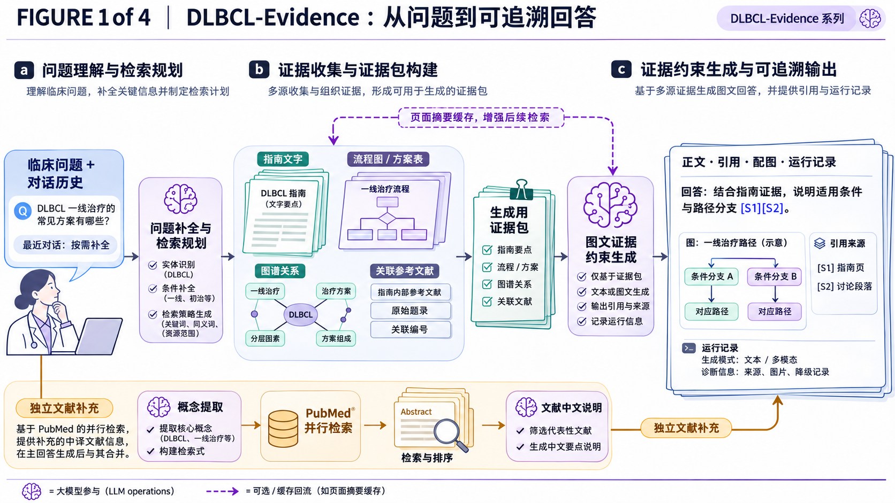
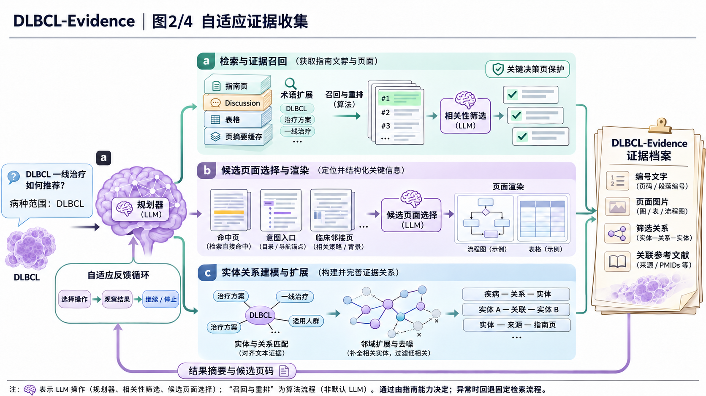
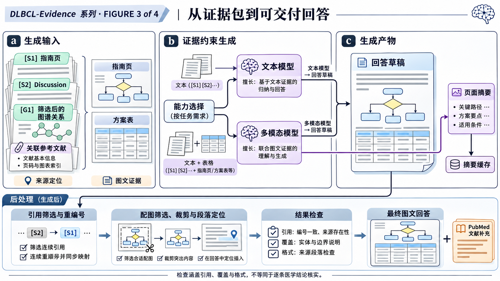
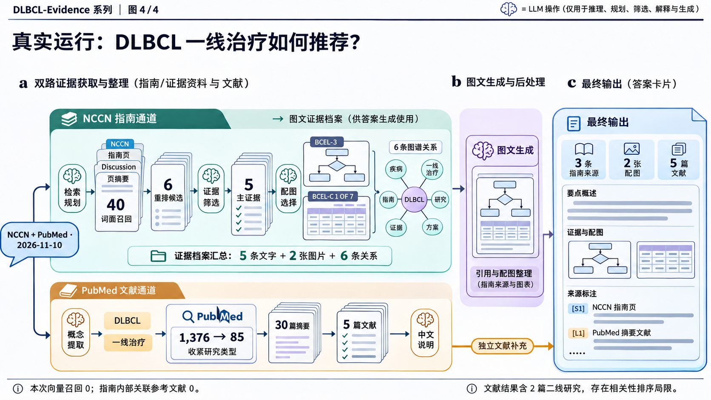

<div align="center">

# DLBCL-Evidence

### Read the guideline. Follow the pathway. Trace the evidence.

**面向淋巴瘤指南的自适应检索与多模态问答系统**

Evidence-grounded lymphoma guideline QA with agentic retrieval, flowchart understanding and traceable citations.


[核心能力](#核心能力) · [快速开始](#快速开始) · [算法文档](#算法文档) · [贡献](#参与贡献)

</div>

临床指南中的答案往往横跨**正文、Discussion、流程图和方案表**。DLBCL-Evidence 将这些材料组织成带来源定位的证据包，按需交给文本或视觉模型，再把回答、引用和配图一起呈现。

支持 NCCN、CSCO 与 EHA 三种主指南来源；**每条问题选择一个主来源**。可选 PubMed 检索提供独立的摘要级文献补充。

<p align="center">
  
</p>

## 核心能力

| 能力 | 实现方式 | 用户获得什么 |
| --- | --- | --- |
| 自适应证据收集 | 模型规划检索、候选选页及按需图谱查询 | 根据问题组织材料的过程记录 |
| 指南文字检索 | 中英文术语扩展、病种元数据约束、BM25 与重排 | 带页码和原文的证据条目 |
| 流程图与方案表 | NCCN 候选页选择、多模态生成、PDF 几何裁剪 | 与回答关联的原始指南配图 |
| 引用溯源 | 引用筛选、重编号与来源卡片 | 可定位的指南来源与关联参考文献 |
| PubMed 补充 | 概念提取、检索式调整、摘要获取与排序 | 使用独立文献编号的中文说明 |
| 连续对话 | 历史补全、流式输出、消息分支与会话保存 | 追问、重新生成和只读分享 |

默认使用词面检索与词面重排；向量索引可选，**不需要先下载本地 embedding 模型或准备 GPU**。正式生成调用外部模型服务。

## 算法如何工作

1. **理解问题**：根据最近历史补全追问，识别话题变化与病种范围。
2. **收集材料**：规划模型选择搜索、选页及按需关系查询；确定性算法执行召回、排序和来源定位。
3. **组装证据包**：汇合编号文字、关联参考文献、页面图片及筛选后的图谱关系。
4. **生成与整理**：选择文本或多模态生成，再执行引用整理、配图定位、展示裁剪与检查。
5. **追加文献补充**：若启用 PubMed，文献通道并行运行，在主回答生成后追加独立说明。

PubMed 结果不参与此前的指南主回答生成。当前检查主要覆盖引用、实体覆盖与格式，不能据此认定每条临床结论均已被证据验证。

<details>
<summary><b>查看证据收集与生成细节</b></summary>





</details>

## 快速开始

推荐 Python 3.11。请自行准备具有合法使用权限的指南 PDF；仓库不提供指南原文件、预构建知识库、账号数据库或 API 密钥。

### 1 安装

```bash
git clone https://github.com/CHEN814/Guideflow.git
cd Guideflow
python -m venv .venv
```

激活环境后安装依赖：

```bash
# Windows PowerShell
.\.venv\Scripts\Activate.ps1
# macOS / Linux
# source .venv/bin/activate

pip install -r requirements.txt
```

### 2 配置模型与指南

在项目根目录新建 `.env`，填写实际配置：

```dotenv
QWEN_API_KEY=your_text_model_api_key
VLM_API_KEY=your_vision_model_api_key
AUTH_SECRET=replace_with_a_long_random_secret
AUTH_ALLOW_PASSWORD_RESET=0
```

在 `config.yaml` 的 `paths.pdf` 和 `sources.nccn.pdf` 中配置实际 NCCN PDF 路径；默认解析配置针对 **B-Cell Lymphomas V3.2026**，换用其他版本时需核对解析规则与页码。

默认模型服务为 DashScope，模型为 `qwen-plus` 与 `qwen3-vl-plus`；环境变量可覆盖。模型调用可能产生服务费用。没有视觉服务时，页面相关回答能力会降级。完整配置见[环境配置指南](docs/环境配置.md)。

### 3 构建 NCCN 知识库

```bash
python scripts/build_knowledge_base.py
python scripts/build_bm25_index.py --source nccn
python scripts/build_knowledge_graph.py --source nccn
```

### 4 启动 Web

```bash
python -m uvicorn backend.api.server:app --host 127.0.0.1 --port 8001
```

浏览器打开 **http://127.0.0.1:8001/app/**。前端由后端直接挂载，无需 npm 构建；在界面中选择指南来源，按需开启 PubMed。

也可以使用 CLI：

```bash
python scripts/ask.py "DLBCL 一线治疗如何推荐？" --trace
```

CLI 的 `--trace` 用于显示来源与日志位置；PubMed 目前通过 Web 请求开关启用，不能把 `--trace` 当作文献开关。

<details>
<summary><b>构建 CSCO 或 EHA 来源</b></summary>

先在 `config.yaml` 的相应来源中配置实际 PDF 路径，再运行：

```bash
# CSCO：同时构建知识库和 BM25 索引
python scripts/build_knowledge_pipeline.py --source csco

# EHA：构建知识库，再建索引
python scripts/build_paper_knowledge_base.py --source eha
python scripts/build_bm25_index.py --source eha
```

EHA 构建支持离线视觉表格转录；可用 `--skip-vlm` 跳过，但可能缺少表格内容。当前在线问答中，CSCO 和 EHA 默认关闭页面视觉工具与图谱工具，使用章节文字和结构化表格。

</details>

## 一次真实运行

问题：**DLBCL 一线治疗如何推荐？**

2026-11-10 的一次本地联网验证采用 NCCN 主来源并开启 PubMed，禁用题录和摘要缓存：

| 阶段 | 实际数量 |
| --- | --- |
| 指南词面召回 → 重排 → 门控后 | 40 → 6 → 5 |
| 生成用页面图片 | 2 张 |
| 生成上下文中的图谱关系 | 6 条 |
| PubMed 命中 → 收紧研究类型后 | 1,376 → 85 |
| 获取摘要 → 最终文献 | 30 → 5 |
| 最终指南来源及配图 | 3 条来源、2 张配图 |



这是本地工作快照的一次运行说明，**不是准确率、速度或临床有效性基准**，也不表示所有本地改动均已发布。文献中含两篇二线治疗研究，说明当前线次相关性排序仍需改进；外部索引、模型与缓存变化也会影响后续结果。

## 算法文档

- [算法设计与实现](docs/DLBCL-Evidence算法设计与实现.md)：问题理解、证据表示、检索规划、图文生成、文献补充及局限。
- [下载 Word 方法文档](docs/DLBCL-Evidence算法设计与实现.docx)：完整章节、配置表与四张横向附图。
- [环境配置](docs/环境配置.md)：模型服务、指南路径、索引及部署参数。
- [数据组织](docs/数据组织.md)：知识库对象与来源定位。
- [前端开发指南](frontend/开发指南.md)：界面、接口与联调。

算法插图采用 ChatGPT 绘图功能制作，用于解释系统结构；精确行为以正文和代码为准。部分早期文档可能滞后，请结合当前实现核对。

## 项目结构

```text
backend/       FastAPI、问答编排、检索、图文处理与会话
frontend/      无构建步骤的 Web 界面
scripts/       指南解析、索引、图谱构建及 CLI
tests/         检索、引用、配图、鉴权等测试
eval/          评测脚本与题目
docs/          算法说明、配置指南和插图
config.yaml    非密钥配置
```

`data/`、`logs/` 和模型缓存由本地构建或运行产生，不随仓库分发。Neo4j 为可选服务。

## 当前边界

- 用于研究、开发和指南信息检索；诊疗使用需要专业人员核对原始指南与患者条件。
- 引用存在、检查通过与临床判断正确是不同层面；目前没有逐结论证据核验的自动闭环。
- 指南解析具有版本依赖；文献为摘要级，内部排序层级不等同于官方推荐等级。
- 公开部署前需配置强 `AUTH_SECRET`、HTTPS 与安全 Cookie，并关闭演示性免验证密码重置。
- 仓库目前未声明开源许可证；指南和文献内容的使用另受相应权利约束。

## 参与贡献

欢迎通过 [Issues](https://github.com/CHEN814/Guideflow/issues) 提交可复现问题或改进建议，尤其是：

- 指南新版解析和表格、流程页定位。
- 病种、人群与治疗线次的检索匹配。
- 引用支持核验与系统评测。
- 配图完整性、流式展示和使用体验。

提交问题时请附指南版本、问题文本、运行方式和去除敏感信息后的诊断记录。**请勿上传真实患者标识、原始病历或服务密钥。**

如果这个项目对你有帮助，欢迎 Star，也欢迎分享你希望它解决的具体问题。
